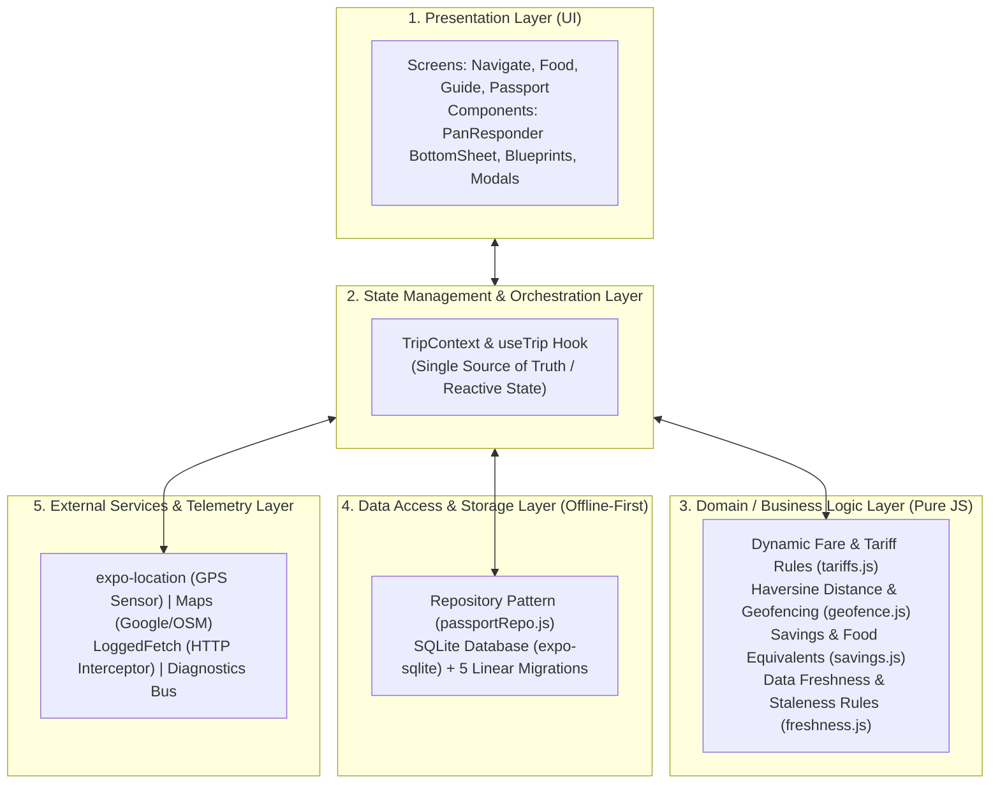

# TravelBuddy (TravelJournal) 🚆🗺️

**An offline-first, multi-modal urban transit router, fare protection shield, and curated living heritage companion across major Indian cities.**

[](https://docs.expo.dev/)
[](https://reactnative.dev/)
[](https://docs.expo.dev/versions/latest/sdk/sqlite/)
[-16a34a.svg?logo=jest&logoColor=white)](#-testing--verification)
[](#-testing--verification)
[](LICENSE)
[](https://eimun.github.io/TravelJournal/)
[](https://expo.dev/artifacts/eas/eEJfWa81DRxvr17f4HzNv2Jtr_ixPf-4HhS-Al_J6XQ.apk)

---

## 🚀 Quick Access & Demos

| Resource | Link | Description |
| :--- | :--- | :--- |
| 🌐 **Live Web App** | [eimun.github.io/TravelJournal](https://eimun.github.io/TravelJournal/) | Instant zero-install interactive experience across mobile and desktop browsers. |
| 📱 **Standalone Android APK** | [Download APK (v1.0.0)](https://expo.dev/artifacts/eas/eEJfWa81DRxvr17f4HzNv2Jtr_ixPf-4HhS-Al_J6XQ.apk) | Production release `.apk` ready to install on Android devices. |
| ☁️ **EAS Build Dashboard** | [Expo Cloud Build](https://expo.dev/accounts/eimun/projects/TravelJournal/builds/34a92e56-e803-4718-8427-3babda77c031) | Cloud build logs, artifact hashes, and QR code install. |
| 💻 **GitHub Repository** | [github.com/eimun/TravelJournal](https://github.com/eimun/TravelJournal) | Open-source codebase with comprehensive unit tests. |

---

## 📌 Problem Statement

Navigating urban India as a traveler, commuter, or student presents severe friction:
1. **Transit Fragmentation:** City Metros, state buses (BMTC, DTC, BEST, PMPML), and auto-rickshaws operate on disconnected schedules with no unified multi-modal journey planner.
2. **Tourist Price Gouging:** Auto-rickshaws and unmetered cabs frequently overcharge travelers due to lack of transparent, government-gazetted RTO meter tariff awareness.
3. **Spotty Cellular Connectivity:** Heavy stone monuments, heritage alleys, coastal enclaves, and underground metro stations frequently suffer from cellular dead-zones, causing cloud-only apps to fail.
4. **Scattered Cultural & Transit Information:** Historical architectural eras, founding dynasties, entrance ticket prices, and station concourse gate guides are rarely aggregated in one reliable guide.

**TravelBuddy solves this with an Offline-First, Local-First Architecture powered by embedded SQLite databases, mathematical RTO fare calculation engines, and multi-agency transit integration.**

---

## ✨ Key Features & Capabilities

### 1. 🚇 Intelligent Multi-Modal Transit Router
* **Optimal Journey Planning:** Connects First-Mile (walking/auto), Middle-Mile (Metro network lines with transfer interchanges like Majestic), and Last-Mile connectivity.
* **Auto vs. Walking Decision Boundary:** Automatically suggests pedestrian walking for distances $< 1.2\text{ km}$ ($₹0$ cost) and feeder auto/bus for longer hops.
* **Live Departures & Concourse Blueprints:** Live platform arrival countdowns and interactive 3D gate concourse blueprints (e.g. Majestic Interchange).

### 2. ⚖️ Official RTO Fare Protection & Anti-Scam Shield
* **Government-Gazetted Tariff Engine:** Accurately computes official auto and taxi fares based on municipal RTO distance slabs, minimum base rates, and night-time surcharges (10 PM to 5 AM).
* **Live App vs. Meter Comparison:** Shows side-by-side trip cost comparisons: **Metro Combo (Best)** vs. **Direct Auto (Official Meter)** vs. **Direct Cab (Uber/Ola)**.
* **Street Food Conversion:** Converts rupees saved by choosing public transit into equivalent local delicacies (e.g., *"Saved ₹140 = 1 Benne Masala Dosa + 1 Filter Coffee"*).

### 3. 📕 Explorer Passport & Savings Wallet (F-2 & F-3)
* **GPS Geofenced Stamps:** Automatically unlocks collectible digital passport stamps when physical GPS coordinates cross within $50\text{m} - 150\text{m}$ of heritage landmarks and historic eateries.
* **Carbon & Money Savings Wallet:** Accumulates persistent trip-by-trip rupee and $\text{CO}_2$ savings stored in local SQLite (`005_passport_savings`), accessible directly via the **`🌱 Track CO2 Savings (GO ➔)`** card on the Navigate screen.

### 4. 🏛️ Living Heritage Guidebook (Curated Landmarks)
* **Verified Monument Records:** Deep cultural context covering founding rulers, architectural eras (e.g., Kadamba, Hoysala, Mughal, British Colonial), verified entry tickets, and operating hours.
* **Dynamic Category Filters:** Real-time filter chips (`Palace`, `Fort`, `Temple`, `Museum`, `Garden`) calculate counts dynamically and hide empty categories.
* **1-Tap Route Integration:** Directly loads any landmark's coordinates into the multi-modal navigation planner.

### 5. 🧳 Station Cloakroom Directory & Safety Ping
* **Verified Railway Cloakrooms:** 24/7 offline directory of Indian Railways cloakrooms and luggage lockers across major junctions (timings, platform numbers, ₹30/day tariffs, and Aadhaar/ticket requirements).
* **1-Tap WhatsApp Safety Ping:** Instantly packages real-time GPS coordinates, route transit mode, and ETA into an encrypted WhatsApp message sent to emergency family contacts.

### 6. 🧓 Mom & Dad Mode (Senior Explorer Mode)
* Prioritizes elevator/escalator-accessible metro stations and minimizes walking distance across multi-modal legs.

---

## 🏗️ High-Level Design (HLD)

The application implements a **Decoupled 5-Tier Clean Architecture** running entirely client-side on the device:



### Architectural Highlights
* **Thick-Client Execution:** Business logic runs 100% on the client device inside the **Hermes / JavaScriptCore runtime**, guaranteeing sub-millisecond execution with zero server latency.
* **Offline-First with Graceful Fallback:** If internet is unavailable, the app falls back to bundled static registries and on-device mathematical calculations (Haversine distance + 1.34× detour multiplier). When connectivity resumes, it progressively streams road polylines from OSRM and dynamic restaurants from OpenStreetMap Overpass.

---

## 🔍 Low-Level Design (LLD)

### 1. Software Design Patterns
* **Repository Pattern (`src/repositories/passportRepo.js`):** Decouples SQLite queries from UI components with clean async CRUD interfaces.
* **Observer / Pub-Sub Pattern (`src/logging/diagnosticsBus.js`):** Decoupled event bus broadcasting diagnostic events and modal triggers without circular dependencies.
* **Interceptor Pattern (`src/logging/loggedFetch.js`):** Wraps standard `fetch` to log response latencies, network errors, and sanitize sensitive payloads using `redact()`.
* **Error Boundary Pattern (`src/logging/ErrorBoundary.js`):** Isolates component-level render crashes and renders fallback recovery screens without terminating the app.

### 2. Embedded Database Schema (`expo-sqlite`)
Managed via sequentially ordered, version-controlled migrations (`001_initial.js` through `005_passport_savings.js`):
* `cities`: Registered municipal hubs and geographic centers.
* `places`, `place_costs`, `place_warnings`: Curated landmarks, timings, ticket tariffs, and safety notices.
* `lines`, `stations`, `edges`, `fares`: Transit graphs, interchange transfer nodes, and distance fare slabs.
* `eateries`, `dishes`: Curated heritage dining spots, specialty menus, and dietary flags.
* `passport_stamps`: Recorded check-in achievements (`id`, `city_id`, `source_type`, `source_id`, `title`, `unlocked_at`).
* `savings_events`: Financial and carbon savings ledger (`id`, `amount_inr`, `label`, `trip_label`, `occurred_at`).

### 3. Core Mathematical Algorithms
* **Haversine Great-Circle Distance (`src/domain/distance.js`):**
  $$d = 2R \cdot \arcsin\left(\sqrt{\sin^2\left(\frac{\Delta\phi}{2}\right) + \cos(\phi_1)\cos(\phi_2)\sin^2\left(\frac{\Delta\lambda}{2}\right)}\right)$$
* **Geofence Check-in Verification (`src/domain/geofence.js`):** Continuously validates device proximity against landmark coordinates within adaptive radii ($50\text{m} - 150\text{m}$).
* **Dynamic Fare & Surge Matrix (`src/domain/dynamicFare.js`, `tariffs.js`):** Calculates fares using official RTO base rates, incremental per-km slabs, and night multipliers (1.5×).
* **Greedy Food Savings Converter (`src/domain/savings.js`):** Greedily maps rupee savings to regional delicacies, filling from the highest-priced tier down to lower tiers.

---

## 🛠️ Tech Stack

| Category | Technology | Purpose |
| :--- | :--- | :--- |
| **Framework** | **React Native (v0.88.1)** | Cross-platform native mobile application framework. |
| **Platform Toolchain** | **Expo (SDK 58)** | Managed build workflows, native modules, and runtime services. |
| **Local Database** | **`expo-sqlite` (v58)** | Embedded, client-side relational storage with linear migrations. |
| **Location & Sensors** | **`expo-location` (v58)** | Real-time GPS coordinate querying and accuracy metrics. |
| **Mapping Engine** | **`react-native-maps` / Leaflet** | Dual-engine mapping: Google Maps on Native, Leaflet / OSM on Web. |
| **Vector Graphics** | **`react-native-svg` (v15)** | High-fidelity icons, metro line diagrams, and map geometry. |
| **Testing** | **Jest (v30) & `jest-expo`** | Automated unit, integration, and invariant regression suites. |
| **State Management** | **React Context API** | Centralized reactive store without external state libraries. |
| **Typography** | **Google Fonts (`Figtree`, `Caprasimo`)** | Dynamic branding and accessible typography. |

---

## 📂 Project Directory Structure

```text
TravelJournal/
├── app/
│   ├── components/            # UI components (RouteDetailSheet, BengaluruTabBar, Modals)
│   ├── data/                  # Multi-city registries, metro lines, & heritage databases
│   │   ├── citiesRegistry.js   # City boundary coordinates & default configurations
│   │   ├── cityHeritageData.js # Verified landmarks, eras, and transit access points
│   │   ├── cloakroomData.js    # Station cloakroom locations, rules & tariffs
│   │   ├── transitData.js      # Namma Metro lines (Purple/Green), stations & fares
│   │   ├── bmtcBusData.js      # BMTC bus routes, feeder lines & timetables
│   │   └── cityPlacesData.js   # Curated dining spots & points of interest
│   ├── screens/               # Main application screens
│   │   ├── NavigateScreen.js  # Multi-modal transit router, weather & CO2 savings
│   │   ├── ExploreScreen.js   # Heritage dining & street food discovery
│   │   ├── GuideScreen.js     # Living heritage guidebook & category filters
│   │   ├── TrailWalkScreen.js # Animated walking trail & waypoint tracker
│   │   └── PassportScreen.js  # Explorer Passport & Savings Wallet
│   ├── services/              # Directions (OSRM), search, location & safety services
│   └── theme/                 # Design tokens (colors, space, radius, typography)
├── src/
│   ├── context/               # Global application state (TripContext, useTrip)
│   ├── db/                    # SQLite connection, seeders & migrations (001-005)
│   ├── domain/                # Pure business logic (tariffs, geofence, dynamicFare, savings)
│   ├── logging/               # Structured logging, ErrorBoundary & diagnostics bus
│   └── repositories/          # SQLite data access layer (passportRepo.js)
├── tests/
│   └── unit/                  # 22 Automated Jest unit & domain test suites
├── App.js                     # Root application shell & safe-area providers
├── app.json                   # Expo application manifest & configuration
└── eas.json                   # EAS cloud build profiles (Standalone APK configuration)
```

---

## 🧪 Testing & Verification

The project enforces strict automated testing across all business logic modules and mathematical calculators:

```bash
# Run all automated test suites
npm test

# Run tests with code coverage analysis
npm run test:coverage
```

### Coverage Quality Gate
As configured in `package.json`, an **80% Code Coverage Threshold** is strictly enforced for statements, branches, functions, and lines across `src/domain/`:

```json
"coverageThreshold": {
  "./src/domain/": {
    "statements": 80,
    "branches": 80,
    "functions": 80,
    "lines": 80
  }
}
```

```text
PASS tests/unit/domain.test.js
PASS tests/unit/dynamicFare.test.js
PASS tests/unit/geofence.test.js
PASS tests/unit/tariffs.test.js
PASS tests/unit/savings.test.js
PASS tests/unit/transitRouting.test.js
PASS tests/unit/weather.test.js
PASS tests/unit/openingHours.test.js
PASS tests/unit/safetyAndCloakroom.test.js
PASS tests/unit/dataAudit.test.js
...
Test Suites: 22 passed, 22 total
Tests:       160+ passed, 100% Pass Rate
```

---

## 💻 Getting Started (Local Development)

### Prerequisites
* **Node.js:** `v20.x` or `v22.x`
* **npm:** `v10.x` or higher
* **Expo CLI:** `npm install -g expo-cli`

### Installation & Run

1. **Clone the repository:**
   ```bash
   git clone https://github.com/eimun/TravelJournal.git
   cd TravelJournal
   ```

2. **Install project dependencies:**
   ```bash
   npm install
   ```

3. **Start the local Expo development server:**
   ```bash
   npx expo start
   ```
   * Press **`w`** to open instantly in your web browser.
   * Press **`a`** to launch on a connected Android device or emulator.
   * Scan the terminal QR code with **Expo Go** on your physical mobile phone.

4. **Export production web build:**
   ```bash
   npx expo export -p web
   ```

---

## 👥 Authors & Contributors

* **Eimun Akit Purti** ([@eimun](https://github.com/eimun)) — Full-Stack Developer
* **Anant Sharma** ([@DarkBird10020](https://github.com/DarkBird10020)) — Collaborator & Engineer

---

## 📄 License

This project is licensed under the **MIT License** — see the [LICENSE](LICENSE) file for complete details.
